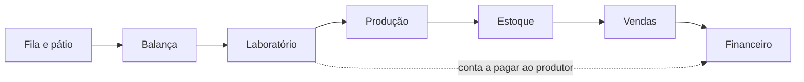

<div align="center">


# SIGFEC

**Sistema integrado de gestão para fecularia**

Do pátio ao financeiro, em um só sistema.

[](https://sigfec.onrender.com)


</div>

Trabalho de Conclusão de Curso de **Sistemas de Informação** da Universidade Paranaense (UNIPAR), Paranavaí, 2026.

- **Autor:** Pedro Heitor Oliveira Silva
- **Orientador:** Prof. Me. Jaime William Dias

## Sobre o projeto

A Fecularia Loanda processa cerca de 400 toneladas de mandioca por dia, com controle feito em planilhas e sistemas isolados. O SIGFEC substitui esse controle por uma única plataforma web, com rastreabilidade da carga recebida até o lote produzido e o pagamento ao produtor.



## Funcionalidades

| Módulo | O que faz |
|---|---|
| **Fila e pátio** | Senha do dia, checklist de 10 itens da carga e painel de chamadas para a TV do pátio |
| **Pesagem** | Peso líquido e peso final com desconto de impureza, romaneio diário |
| **Laboratório** | Laudo com 2 a 4 amostras, renda média, classificação e conta a pagar ao produtor gerada automaticamente |
| **Produção** | Lotes com rendimento e custo unitário, entrada no estoque e resíduo fibroso automático |
| **Estoque** | Histórico Kardex de cada movimento e ajuste por contagem, entrada ou saída |
| **Vendas** | Orçamento, confirmação com baixa de estoque, parcelamento e número de nota sequencial |
| **Financeiro** | Contas a pagar e a receber, baixa parcial, estorno e cobrança PIX/Boleto pelo Asaas com confirmação por webhook |
| **Relatórios** | 9 relatórios gerenciais com filtros, PDF e exportação para Excel |
| **Administração** | Perfis e permissões por usuário, parâmetros do sistema e trilha de auditoria |

O sistema abre no navegador do computador e do celular e pode ter um atalho na tela inicial (PWA).

## Tecnologias

| Camada | Tecnologias |
|---|---|
| **Telas** | React 18, Vite, Tailwind CSS, PWA |
| **API** | Java, Spring Boot 4, Spring Security, JWT, JPA/Hibernate |
| **Banco** | PostgreSQL |
| **Integração** | Asaas (PIX e boleto) |
| **Publicação** | Docker, Render e Neon |
| **Testes** | JUnit 5 e Mockito (54 testes) |

## Como rodar

**Pré-requisitos:** JDK 17 ou superior, Node.js e PostgreSQL com um banco `sigfec_db` na porta 5432.

Backend, na porta 8080:

```bash
cd SIGFEC-backend
./mvnw spring-boot:run -Dmaven.compiler.release=17
```

Telas, na porta 5173:

```bash
npm --prefix sigfec-front install
npm --prefix sigfec-front run dev
```

Testes:

```bash
cd SIGFEC-backend
./mvnw test -Dmaven.compiler.release=17
```

As variáveis `DB_URL`, `DB_USER`, `DB_PASSWORD` e `SIGFEC_JWT_SECRET` configuram o ambiente de produção. O passo a passo da publicação está em [deploy/NUVEM-GRATIS.md](deploy/NUVEM-GRATIS.md).

## Estrutura

```text
SIGFEC-backend/   API em Spring Boot (controllers, services, entidades)
sigfec-front/     Telas em React
scripts/          Dados de demonstração
deploy/           Guias e scripts de publicação
Dockerfile        Imagem única com telas e API
```

---

<div align="center">Feito por Pedro Heitor Oliveira Silva · UNIPAR · 2026</div>
